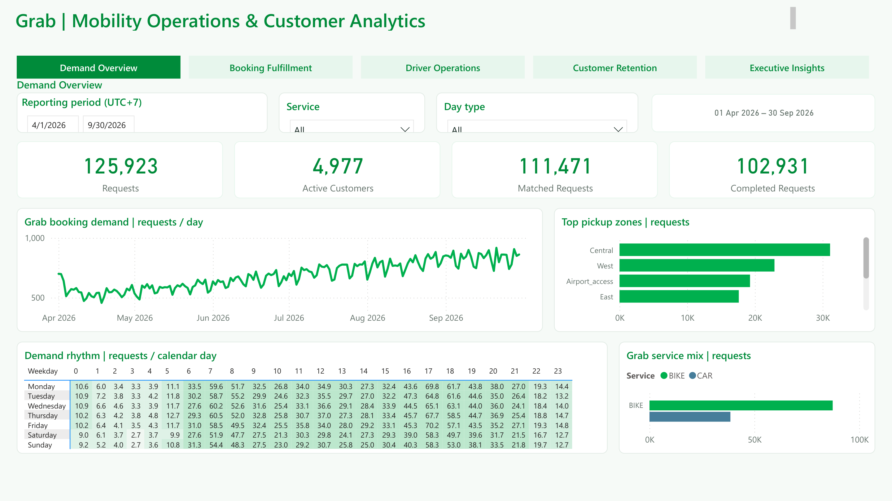
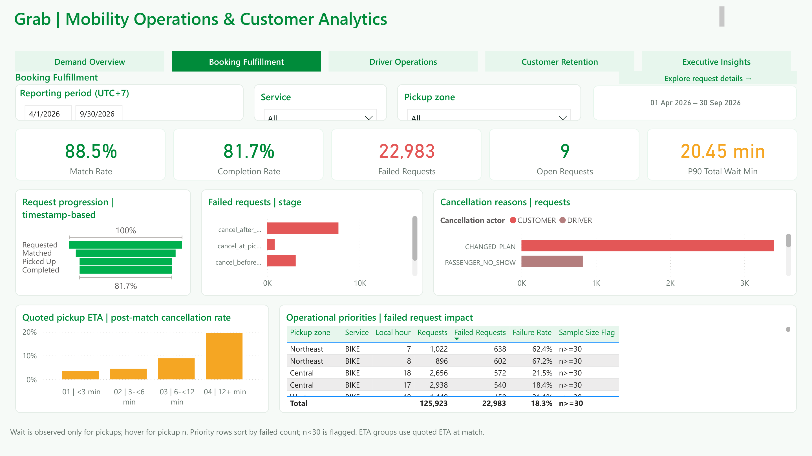
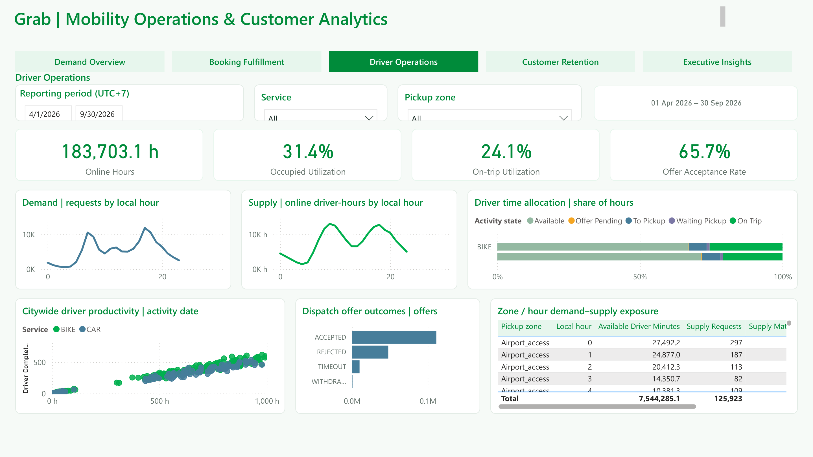
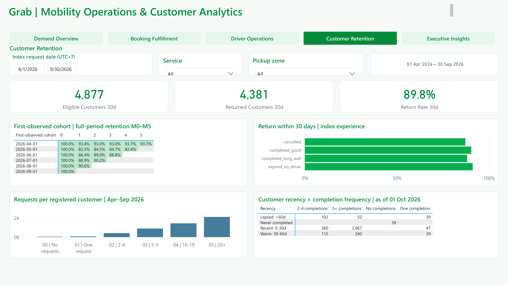

# Grab-Inspired Ride-Hailing Analytics | SQL Server & Power BI

**Synthetic Data from April–September 2026**

## Project Overview

Operation teams must balance booking demand, nearby driver availability, pickup waiting time, and customer experience. This project examines where requests fail and which operational problems deserve a controlled test.

I used SQL Server to validate and prepare data, define KPIs, analyze demand and fulfillment, measure driver exposure, and compare customer return patterns. Power BI brings these analyses together in four core report pages. The focus is practical analytical work: preserving table grain, choosing clear denominators, handling incomplete follow-up, and turning evidence into testable recommendations.

The dataset is entirely synthetic. Results describe this simulation and are not Grab operating statistics.

## Data Sources & AI-Assisted Data Generation

Public sources informed concepts such as booking entities, driver matching, cancellation experiments, and dimensional modeling. Transaction records were simulated locally; they were not downloaded from those sources or empirically calibrated to Grab operations.

AI assisted development of the Python generator. Read the [Data Generation Methodology](docs/data_generation.md) for sources, code examples, validation results, and the AI disclosure.

## Business Questions

1. Where and when is booking demand highest?
2. How successfully are requests matched and completed?
3. At which stages do cancellations occur?
4. How does local driver availability relate to demand?
5. How does index-request experience relate to future booking behavior?
6. Which operational changes should be tested next?

## Tools & Technologies

SQL Server · T-SQL · Power BI Desktop · DAX · Power Query. Python was used for the AI-assisted synthetic generator and data validation; it is supporting methodology, not a claim of independent Python engineering expertise.

## Dataset Overview

Requests cover **1 April–30 September 2026**, with an exclusive cutoff of **1 October 2026 00:00**, local UTC+7. The simulation has 5,000 registered users, 1,000 drivers, seven approximate operating zones, and generic BIKE/CAR services.

| Main source | Rows | Grain |
|---|---:|---|
| Booking requests | 125,923 | One request, including failed and open requests |
| Dispatch offers | 169,829 | One offer to one driver |
| Driver sessions | 32,981 | One online session |
| Driver state intervals | 689,936 | One continuous online state interval |
| Supply exposure | 245,952 | 15 minutes × zone × service |
| Synthetic weather | 30,744 | Hour × zone |

Requests represent 121,297 independent journeys and 4,977 requesting customers. Offers are kept separate from requests. Demand is aggregated before joining supply exposure. Driver intervals are split at midnight. The report uses 18 tables and 23 active, single-direction dimension-to-fact relationships, plus deliberately disconnected analytical/helper tables.

See the [verified model diagram](docs/data_model.png), [data dictionary](docs/data_dictionary.md), and [KPI dictionary](docs/kpi_dictionary.md).

## Analytical Workflow

Data Validation → Data Preparation → Demand Analysis → Fulfillment Analysis → Driver Supply Analysis → Customer Retention → Business Recommendations → Power BI Dashboard.

Technical examples include CTEs, conditional aggregation, window functions, percentile calculations, calendar exposure, interval splitting, and observation-window eligibility. Reusable view definitions are separate from analytical SELECT queries.

## Dashboard Preview

These 4 pages were exported directly from the updated PBIX through Power BI Desktop All 4 previews use synthetic data; see [capture evidence](evidence/dashboard_capture.json).

**Demand Overview:** daily requests, calendar-day-normalized weekday/hour demand, pickup zones, and service mix.

**Booking Fulfillment:** timestamp funnel, cancellation stages, ETA groups, and impact-ranked failure cells.

**Driver Operations:** online exposure, utilization, offer decisions, and activity-date productivity.

**Customer Retention:** eligible 30-day return, first-observed monthly cohorts, and fixed-period customer profiles.

## Key Findings

The following values were checked through read-only SQL Server. [Evidence](evidence/verified_metrics.json) and the [executive findings](docs/key_findings.md) provide denominators and interpretation.

| Finding | Verified result | Business interpretation and next step |
|---|---|---|
| Fulfillment loss | 22,983 / 125,923 requests failed (**18.25%**); nine remained open | Prioritize cells by failed volume and rate; test morning availability in Northeast BIKE. |
| Long waits after a successful match | 22,124 / 102,931 completions waited >12 minutes (**21.49%**) | Test pickup-time-aware assignment; track timely completion across all assigned requests. |
| Cancellation after acceptance | 8,532 / 111,471 matched requests (**7.65%**) | Test clearer pickup confirmation and communication, with completion and safety guardrails. |
| Different uses of driver time | **31.36%** occupied utilization vs **24.15%** on-trip utilization | Examine approach and pickup waiting separately; citywide averages can hide local shortages. |
| Customer return varies by experience | 4,381 / 4,877 eligible users returned on a new journey (**89.83%**) | Compare groups cautiously; the generator embeds experience-related behavior and the observed pattern is not universally worse after failure. |

## Business Recommendations

- Test pickup-time-aware dispatch in Central BIKE at 17:00 using randomized zone/time blocks. Primary outcome: timely completions per assigned request; monitor completion, expiry, allocation delay, and neighboring zones.
- Test voluntary positioning guidance and a bounded availability incentive for Northeast BIKE mornings. Collect real cost and earnings data before setting an incentive budget.
- Test pickup confirmation and communication after acceptance. Use stable user assignment or a cluster design if spillovers are material. Run overlapping Central interventions sequentially or use a planned factorial design.

A 10% relative reduction in the fixed baseline of 22,983 failures gives **2,298.30 assumed avoided failures**. 

## How to Reproduce

1. Use SQL Server 2017+ and SSMS. Create/select a **new review database** with permission to create views. The scripts use the selected database; they do not create one.
2. Obtain the original reviewed V2 dataset separately. Raw CSVs, identity seeds, and the generator are not distributed in this package. **Do not load the current minute-precision trip CSV as a verified substitute for the database snapshot.** Resolve the discrepancy in [validation](docs/validation.md) first.
3. Review [setup_database.sql](reproducibility/setup_database.sql). Set its `@DataFolder` to a SQL Server-readable CSV directory, including the trailing separator. Run its schema section, then the import section. Use UTF-8 CSV parsing; preserve blank fields as NULL and phone fields as text. Nonempty tables are skipped; this is not an incremental loader.
4. Run [01_data_quality.sql](sql/01_data_quality.sql), then [02_data_preparation.sql](sql/02_data_preparation.sql). The latter creates/updates four views, including the corrected customer summary. Deploy only in the review database.
5. Run scripts **03 → 04 → 05 → 06 → 07** for demand, fulfillment, drivers, customers, and business scenarios. Run [08_powerbi_preparation.sql](sql/08_powerbi_preparation.sql) for eight dashboard preparation views. Script 07 also contains calendar normalization and sensitivity analysis. All scripts expect only this six-month V2 dataset; some original demand queries intentionally retain that full-dataset scope.
6. This package includes screenshots, DAX, theme, and model documentation. The original local project has a PBIX and PBIP. 
7. The imported report uses `v_pbi_trip`, `v_offer_enriched`, `v_pbi_supply`, `v_driver_day`, `v_retention30_user`, `v_cohort_monthly`, and `v_pbi_customer_profile`, plus dimensions. Use the [model](docs/data_dictionary.md) and [implemented DAX](dashboard/measures.dax) when rebuilding. Reconcile unfiltered and sliced counts before export.

## Project Limitations

The simulation uses approximate locations, synthetic weather, simplified dispatch decisions, and built-in demand/experience rules. It has no real GPS, pricing, costs, or competing-platform data. Six months limit retention follow-up and seasonal interpretation. Associations do not establish causal effects or generalize to real Grab operations. See [limitations](docs/limitations.md).

## Disclaimer

**This is an independent case study using synthetic ride-hailing data. It is not affiliated with, endorsed by, or based on proprietary data from Grab.**
